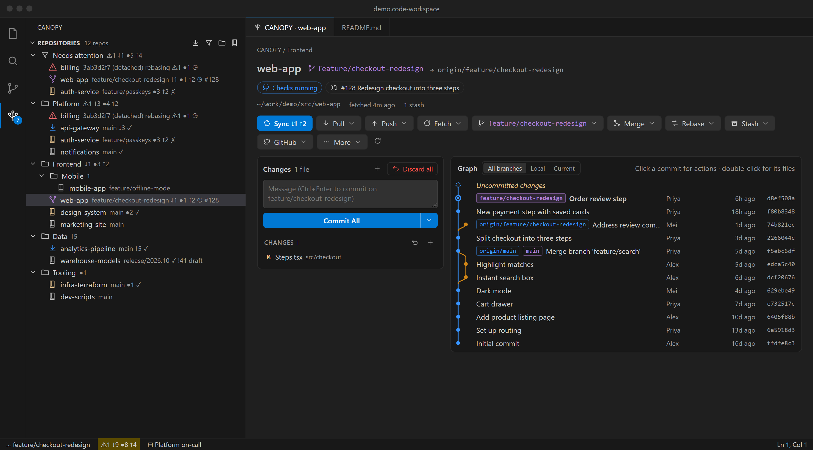
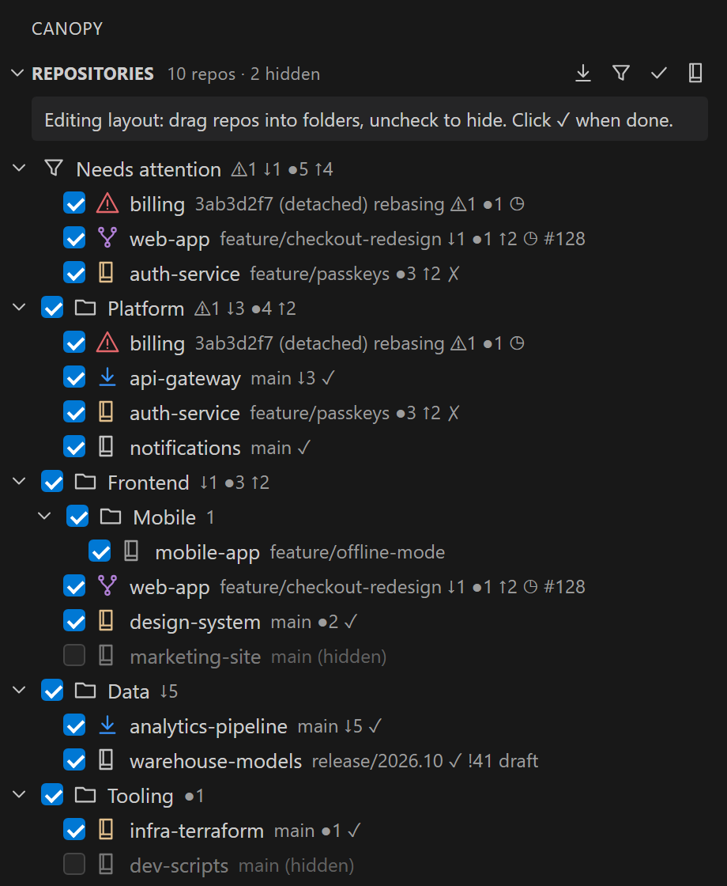
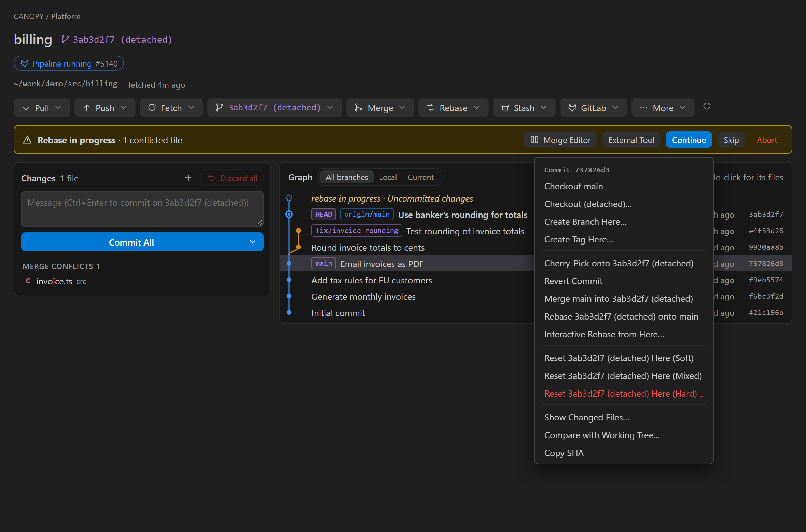
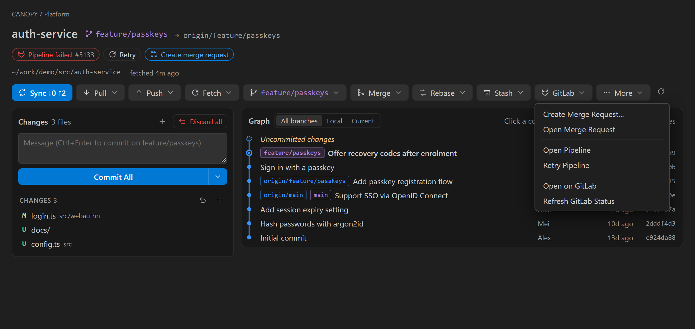
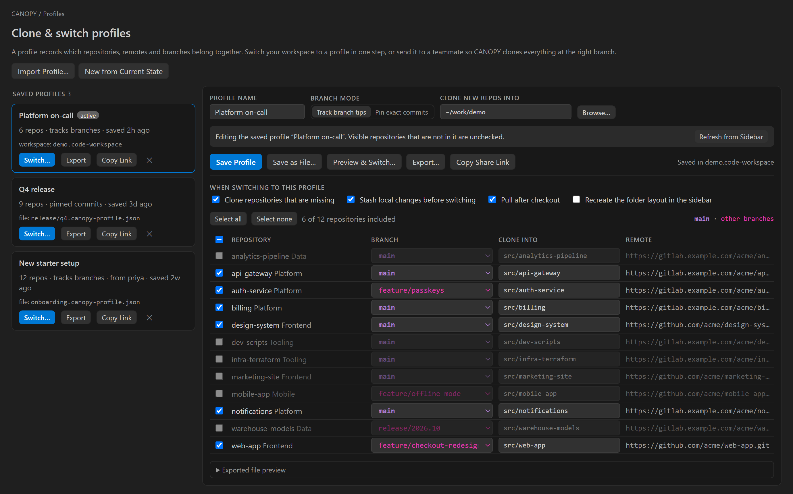

# CANOPY

**Every branch, one view.** CANOPY is a sidebar for people who work across many Git repositories. File repos into your own folders, see at a glance which ones need pulling, pushing or fixing, run any Git operation in one click, follow GitLab and GitHub pipelines, merge requests and pull requests, and share profiles that set up a whole set of repos for a teammate.

## Why CANOPY

VS Code's Source Control view works well for one repository. With ten or fifty, you end up scrolling a long flat list, opening terminals, and guessing which repo is behind. CANOPY adds what's missing:

- **Folders you choose**, independent of where repos sit on disk, saved with your workspace
- **Attention-first sorting:** conflicts first, then incoming commits, local changes, unpushed work
- **Every Git operation** from a toolbar or right-click menu, including rebase, stash, worktrees and merge tools
- **GitLab and GitHub status** next to each repo: pipelines or checks, merge or pull requests
- **Profiles** that record which repos and branches belong together, so you can switch in one step or onboard someone in minutes

## Getting started

1. Install CANOPY and open a folder or workspace that contains Git repositories.
2. Click the CANOPY icon in the activity bar. Repositories in your workspace folders appear automatically.
3. Follow **Get Started with CANOPY** (it opens on first run; run **CANOPY: Get Started** to open it again).

Repositories outside your workspace? Add them with **Add Repository…**, or list extra folders to scan in `canopy.scanRoots`.

## Organize your repositories

- **Folders:** create folders and subfolders, then drag repositories into them. Repos you haven't filed yet appear under **Unsorted**.
- **Smart folders** fill themselves from a query, such as `is:conflict OR pipeline:failed`.
- **Edit Layout** (pencil button) adds a checkbox to every repo. Uncheck one to hide it, then click ✓ when you're done.
- The layout is saved in your workspace (`.code-workspace` or `.vscode/settings.json`), so it stays with the project.

## See what needs attention

Each row shows the repository, its branch, and badges:

| Badge | Meaning |
|---|---|
| `↓3` | 3 commits to pull |
| `●2` | 2 changed files |
| `↑1` | 1 commit to push |
| `⚠` | conflicts, or a merge or rebase in progress |
| `✓ ✗ ◷` | pipeline or checks passed, failed or running |
| `!42` / `#42` | open GitLab merge request / GitHub pull request |

The most urgent state also shows as a colored badge at the right edge, and the repository name takes its color: failed pipeline (red `✕`), commits to push (blue `↑`), commits to pull (green `↓`), then uncommitted changes (yellow `●`). Change these colors in `workbench.colorCustomizations` with `canopy.pipelineFailedForeground`, `canopy.aheadForeground`, `canopy.behindForeground` and `canopy.changesForeground`.

- **Sort** by attention, name, recent activity or your own order. **Group by status** to see Conflicts, Incoming, Local changes and Unpushed at a glance.
- **Filter** by status, or with a query such as `is:dirty age<7d`.
- **Fetch All** (and automatic fetching every few minutes) keeps the counts current. The activity bar badge and status bar show totals.

## Every Git operation, one click away

Click a repository to open its details:

- **Toolbar:** Sync, then Pull, Push, Fetch, Branch, Merge, Rebase, Stash and Prune menus, plus More for commit, cherry-pick, revert, reset, tags, remotes, worktrees and submodules.
- **Changes:** write a commit message (Commit, Commit & Push, Commit & Sync, Amend). Stage, unstage or discard each file, or use **Stage all** and **Discard all**. Clicking a file opens its diff **in the editor beside**. Discards are saved to a safety stash first, so they can be undone.
- **Commit graph:** branches, merges and tags drawn as lanes. Click a commit (or the uncommitted changes row) to list its changed files beneath it; click a file to open its diff. Right-click a commit to check it out, branch or tag from it, cherry-pick, revert, merge, rebase onto it or reset to it.
- **Stats:** switch the graph card to **Stats** for lines of code, commits per week, lines of code over time, authors (commits, lines added and deleted, and lines each author owns today via git blame), languages, an activity heatmap and the most changed files, over 3 months, 1 year or all time. When the repository sits in a CANOPY folder with others, see totals for the whole folder.
- **Profiles:** the third tab shows the clone & switch profile editor (see below) without leaving the details panel.
- **Conflicts:** when a merge or rebase stops, a banner offers the 3-way merge editor, your external merge tool, Continue, Skip and Abort.

Select several repositories in the sidebar to fetch, pull, push, sync or stash them all at once.

## GitLab and GitHub

CANOPY works out which service hosts each repository from its remote, so one workspace can mix GitLab and GitHub repos.

| | GitLab (gitlab.com or self-hosted) | GitHub (github.com or Enterprise Server) |
|---|---|---|
| Build status | Pipeline for the branch, **Retry** | GitHub Actions checks for the newest commit, **Re-run failed jobs** |
| Review | Merge request: draft, conflicts, approvals | Pull request: draft, conflicts, approvals and change requests |
| Create | **Create Merge Request…** (draft, delete branch, squash) | **Create Pull Request…** (draft or ready) |
| Bulk clone | **Clone from GitLab Group…** with subgroups as folders | **Clone from GitHub Organization…** into an organization folder |

Create Merge / Pull Request pushes your branch first if needed and takes the title from your commits.

**Connect GitLab:** run **CANOPY: Connect GitLab…**, or accept the prompt CANOPY shows when your repositories use a GitLab server.

1. Pick the server. CANOPY suggests the ones it finds in your remotes, and you can enter any URL.
2. Select **Open Token Page**. GitLab opens with a token named *CANOPY* and the `api` scope already filled in. Create it.
3. Paste the token. CANOPY checks it and shows which account it belongs to. A `read_api` token works if you only want to see status.

**Sign in to GitHub:** run **CANOPY: Sign in to GitHub…**. CANOPY uses VS Code's own GitHub account sign-in, so there is no token to copy: approve CANOPY in the browser once. For GitHub Enterprise Server, set VS Code's `github-enterprise.uri` setting to your server first. Where VS Code's GitHub sign-in isn't available, CANOPY offers a personal access token instead.

Tokens and sign-ins stay in VS Code's encrypted storage and are only ever sent to the server they belong to.

## Profiles: switch or share a whole set of repositories

A profile records which repositories, remotes and branches belong together.

- **Build one in seconds:** the editor starts with every visible repository on its current branch. Uncheck what you don't need and pick branches.
- **Switch:** CANOPY first shows exactly what will happen to each repo (clone, switch, stash, pull) and runs nothing until you confirm.
- **Share:** save the profile as a `.canopy-profile.json` file in your project, or copy a share link. A teammate opens it and CANOPY clones what they're missing and switches the rest to the right branches.
- **Track branch tips** for day-to-day work, or **pin exact commits** to reproduce a release.

## Query language

Use it for smart folders, filters and **Go to Repository…**.

| Term | Matches |
|---|---|
| `is:conflict` `is:diverged` `is:behind` `is:ahead` `is:dirty` `is:clean` `is:detached` `is:unpublished` | repository status |
| `pipeline:failed` `pipeline:running` `pipeline:success` `is:mr` (or `is:pr`) `is:draft` `is:mr-conflict` | GitLab and GitHub status |
| `name:` `branch:` `path:` `folder:` (with `*` wildcards), `remote:` | names and locations |
| `behind>2` `changes>0` `age<7d` `age>3m` | counts and last-commit age |
| `AND` (or a space), `OR`, `NOT` or `-term`, `( )` | combining terms |

Example: `folder:Platform (is:behind OR pipeline:failed)`

## Settings

| Setting | Default | Description |
|---|---|---|
| `canopy.scanRoots` | `[]` | Extra folders to scan for repositories |
| `canopy.scanDepth` | `3` | How deep to look below each folder |
| `canopy.autoFetch.intervalMinutes` | `5` | Automatic fetch interval (`0` turns it off) |
| `canopy.bulkPullMode` | `ff-only` | How pulls behave across several repositories |
| `canopy.discard.safetyStash` | `true` | Stash changes before discarding them |
| `canopy.graph.maxCommits` | `300` | Commits shown in the graph |
| `canopy.gitlab.refreshMinutes` | `3` | How often GitLab status refreshes |
| `canopy.gitlab.cloneProtocol` | `https` | `https` or `ssh` for group clones |
| `canopy.github.refreshMinutes` | `3` | How often GitHub status refreshes |
| `canopy.github.cloneProtocol` | `https` | `https` or `ssh` for organization clones |
| `canopy.maxConcurrentGit` | `6` | Background Git processes run at once |

All settings are listed under **CANOPY** in the Settings editor.

## Privacy

- CANOPY runs your own `git` and talks only to the GitLab and GitHub servers you connect.
- It sends no telemetry.
- GitLab tokens and GitHub sign-ins stay in VS Code's encrypted storage on your computer.
- Your folder layout and saved profiles are stored in your workspace settings, which you control.

## Requirements

- VS Code 1.95 or later
- Git 2.30 or later (on your `PATH`, or set `canopy.gitPath`)

---

*Screenshots show a demo workspace of fictional repositories.*
